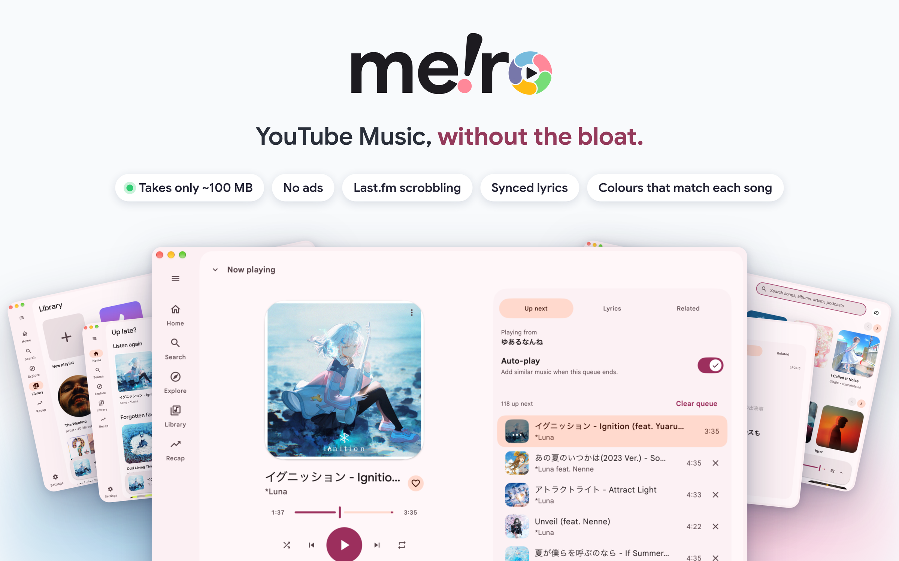

<p align="center">
  <picture>
    <source media="(prefers-color-scheme: dark)" srcset="docs/promo/hero-dark.png">
    
  </picture>
</p>

<p align="center">
  <a href="#install">Install</a> ·
  <a href="#features">Features</a> ·
  <a href="#screenshots">Screenshots</a> ·
  <a href="#troubleshooting">Troubleshooting</a> ·
  <a href="#build-from-source">Build</a> ·
  <a href="CONTRIBUTING.md">Contribute</a>
</p>

A lightweight desktop music player for YouTube Music. Meiro has a native
interface rather than a browser-based one, and typically uses about 100 MB of
memory. It plays music without loading the YouTube Music web page, and can
scrobble your listening to Last.fm.

<p align="center">
  <a href="docs/screenshots/lyrics.png"></a>
</p>

> **Beta and unofficial.** Meiro is an independent project. It is not made,
> endorsed or supported by YouTube or Google, and it uses YouTube's private web
> interfaces, which YouTube can change at any time. When that happens, parts of
> Meiro (browsing, search, playback, sign-in) may stop working until it is
> updated. See [Known issues](#known-issues) and
> [Troubleshooting](#troubleshooting).

## Features

### Find your music

- **Home and Explore.** The same recommendations, new releases and charts you
  see on YouTube Music, plus artist, album and playlist pages.
- **Search.** Look up songs, albums, artists and playlists, and filter the
  results. Your recent searches are saved.
- **Podcasts.** Browse shows and episodes, read episode details, and pick up
  where you left off.
- **Song menus.** Play a song next, add it to a playlist, start a radio from
  it, go to the artist, or copy a link to share.

### Listen

- **No web-page ads.** Meiro plays the music directly instead of loading the
  YouTube Music web page, so it does not show ads from that page.
- **Everything you expect from a player.** Play, pause, skip, shuffle, repeat,
  volume, and a queue you can see and change. A small player follows you while
  you browse, and the full player shows the queue, lyrics and related songs.
- **Lyrics that follow the song.** The line being sung is highlighted as the
  song plays. You can switch to plain text.
- **Music that keeps going.** When your queue ends, Meiro adds similar songs so
  the music does not stop.
- **Pick up where you left off.** Open Meiro again and your queue and song are
  waiting for you.
- **Keeps playing when you close the window.** On macOS and Windows, open the
  mini player from the tray. On Linux, the tray menu offers **Open Meiro** and
  **Quit**; the mini player is not available there.
- **Works with your computer's controls.** Use your media keys, the Now Playing
  widget on Mac, or the media controls on Linux.
- **Share what you hear on Discord.** With Discord or another client that
  supports Discord Rich Presence running, enable Discord Rich Presence in
  Settings → Desktop to show the current track, artist, cover and a time bar
  with the elapsed time and the track's length; the member list shows the
  artist. Some clients require you to enable RPC in their settings. Meiro
  clears the activity when playback pauses or stops.
- **Keyboard shortcuts.** Control music from the keyboard, and change the keys
  to what suits you.

### Your account and library

- **Sign in with your Google account.** Get your personalized Home feed and
  Library.
  Meiro never sees your password. You can still browse and play without
  signing in.
- **Manage your library.** Like songs, follow artists, save albums and
  playlists, and create or delete your own playlists.
- **Organize playlists.** Sort a playlist by title, artist or length, or
  search inside it.

### Make it sound and look yours

- **Equaliser.** Adjust the bass, treble and everything between, or pick a
  preset. Turn on volume levelling so songs play at a similar loudness.
- **Colours and themes.** Light, dark, or follow your computer. Pick a colour,
  or let the app take its colours from the album art of the song playing.
- **Zoom.** Make everything on screen larger or smaller, from 80% to 200%, in
  Settings → Appearance or with `Cmd`/`Ctrl` and `=` or `-`.

### Keep track of what you hear

- **Last.fm scrobbling.** Connect your Last.fm account and Meiro scrobbles the
  tracks you play to your profile. Pause scrobbling any time.
- **Listening stats.** See your listening time by day. The history stays on
  your computer, and you can delete it whenever you like.

### Light and simple

- **Small and quick.** Meiro typically uses about 100 MB of memory, much less
  than YouTube Music in a browser tab.
- **Caches recent songs.** Tracks you played recently load faster next time.
  Choose how many to keep, or turn the cache off.
- **Updates itself.** Meiro checks for new versions once a day. You can turn
  this off.

## Screenshots

Screenshots show Meiro using a signed-in YouTube Music account. Click an
image to see it full size.

<table>
  <tr>
    <td align="center"><a href="docs/screenshots/home.png"></a><br><sub>Home</sub></td>
    <td align="center"><a href="docs/screenshots/explore.png"></a><br><sub>Explore</sub></td>
    <td align="center"><a href="docs/screenshots/library.png"></a><br><sub>Library</sub></td>
  </tr>
  <tr>
    <td align="center"><a href="docs/screenshots/search.png"></a><br><sub>Search</sub></td>
    <td align="center"><a href="docs/screenshots/artist.png"></a><br><sub>Artist</sub></td>
    <td align="center"><a href="docs/screenshots/playlist.png"></a><br><sub>Playlist</sub></td>
  </tr>
  <tr>
    <td align="center"><a href="docs/screenshots/player.png"></a><br><sub>Player and queue</sub></td>
    <td align="center"><a href="docs/screenshots/related.png"></a><br><sub>Related tracks</sub></td>
    <td align="center"><a href="docs/screenshots/stats.png"></a><br><sub>Listening stats</sub></td>
  </tr>
  <tr>
    <td align="center"><a href="docs/screenshots/settings-appearance.png"></a><br><sub>Appearance</sub></td>
    <td align="center"><a href="docs/screenshots/settings-sound.png"></a><br><sub>Equaliser</sub></td>
    <td align="center"><a href="docs/screenshots/settings-keyboard.png"></a><br><sub>Shortcuts</sub></td>
  </tr>
</table>

## Install

Download the latest build for your system from the
[releases page](https://github.com/elianiva/meiro/releases).

### Which file do I download?

The release page lists several files. Choose one for your system:

**Step 1. Find your system.**

| You have | Download the file that ends in |
| --- | --- |
| A Mac (any Mac) | `.dmg` |
| Windows, no installer | `-portable.zip` |
| Ubuntu, Debian, Linux Mint, Pop!_OS | `.deb` |
| Fedora | `.rpm` |
| Any Linux with Flatpak (full build only) | `.flatpak` |
| Arch, Manjaro, or any other Linux | `.AppImage` |

On Windows, you can also choose the `-setup.exe` installer instead.

Arch does not have a native package yet. The `.AppImage` runs without an
installer: make the file executable, then open it.

**Step 2. Choose the right processor (Linux only).** Most computers use
`amd64`. Choose `arm64` only for an ARM computer. To check, open a terminal
and run `uname -m`.

- It prints `x86_64`: choose the file with `amd64` in its name.
- It prints `aarch64`: choose the file with `arm64` in its name.

Macs and Windows need no chip choice. One `.dmg` works on Apple Silicon and on
Intel. Windows downloads are for `amd64`.

**Step 3. Choose a full or minimal build.** The full build is the easiest
option. Files with `-minimal` in the name are for people who already have
`ffmpeg`, `yt-dlp`, and Node.js or Bun installed. Without those tools, playback
will not work. Choose a file without `-minimal` unless you specifically want
the minimal build.

If you do use a minimal build, keep `yt-dlp` up to date (for example
`yt-dlp -U`, or your package manager's latest). An old `yt-dlp` can cause slow
or failed playback.

Do not download files named `update-*.json`, files ending in `.delta`, or the
Windows update `.tar.gz` archive. Meiro uses those files to update itself.
The Linux `.tar.gz` package is for Linux users.

For example, on Ubuntu with a normal Intel or AMD computer, download
`Meiro-<version>-linux-amd64.deb`.

### Install steps

**macOS:** Open the disk image and drag Meiro to Applications. The app is not
notarized by Apple yet, so the first time, right-click it and choose **Open**
(or allow it under System Settings > Privacy & Security).

**Linux:** Install the `.deb` on Debian or Ubuntu, or the `.rpm` on Fedora or a
compatible RPM-based distribution. With Flatpak, run
`flatpak install --user Meiro-<version>-linux-amd64.flatpak`. You can also make the `.AppImage` executable
and run it, or unpack the `.tar.gz` and run its `install.sh`. All Linux builds
need GTK 3 and WebKitGTK 4.1. The tray also needs the AppIndicator runtime:
Debian/Ubuntu packages install `libayatana-appindicator3-1`, and Fedora packages
install `libayatana-appindicator-gtk3`. If you use an AppImage or `.tar.gz`,
install the matching package yourself. Other distributions may use a different
package name.

**Windows portable version:** Extract the `-portable.zip` file, keeping the
files together, then open `Meiro.exe` in the extracted `Meiro` folder. It does
not need an installer or administrator permission. Settings and other user
data stay in your Windows user profile. You can also run the `-setup.exe`
installer. **Windows support is untested.** Please report any problems you
find.

## Signing in

To see your personalized Home feed and Library, choose **Sign in** and then
**Sign in with a browser window**. Meiro opens a separate browser window with a
new, empty profile, and you sign in to your Google account there. Meiro never
sees your password. When the sign-in finishes, Meiro takes the YouTube Music
session from that window, closes it, and deletes its profile.

Meiro opens the window in your system's default browser when that browser is
Chrome, Edge, Brave, Helium, Chromium, Vivaldi, Firefox or Zen. If your
default browser is something else, such as Safari, Meiro uses the first of
those browsers that it finds installed. A Firefox or Zen default that it
cannot find, or cannot read because yt-dlp is missing, falls back to the first
Chromium-based browser it finds. Firefox and Zen need yt-dlp, which Meiro
also needs for playback.

The Flatpak cannot open a browser window until you let it start programs
outside its sandbox. It does not ask for this permission by default. To grant
it, run this command, then restart Meiro:

```sh
flatpak override --user --talk-name=org.freedesktop.Flatpak com.elianiva.meiro
```

To remove the permission again, run
`flatpak override --user --no-talk-name=org.freedesktop.Flatpak com.elianiva.meiro`.
Without it, you can still sign in by importing from a browser or by pasting
the Cookie header.

YouTube Music does not offer a sign-in method for third-party apps. Meiro uses
a browser session, which has the same account access as that browser session.
Treat it like a password.

### Limits of the browser window

- **A supported browser must be installed.** The window needs Chrome, Edge,
  Brave, Helium, Chromium, Vivaldi, Firefox or Zen. Safari cannot be used for
  it, even when it is your default browser. If you have none of the supported
  browsers, use one of the other ways below.
- **Google may refuse the sign-in.** Google may show "This browser or app may
  not be secure" or block the sign-in. Its checks can change at any time. If
  that happens, try one of the other sign-in options below.
- **The window is not your browser.** Your bookmarks, extensions, saved
  passwords and other sessions are not there. You may need to complete a
  second-factor step.
- **Close the window only after it finishes.** If you close it early, the
  sign-in stops and you can try again. A sign-in that takes more than five
  minutes stops by itself.
- **The session can still end.** YouTube can end a session at any time, for
  example when you sign out everywhere or change your password. Meiro then asks
  you to sign in again. A session that you took from the sign-in window is
  never opened in a browser again, so it is not renewed behind your back.

### Other ways to sign in

These are under **Advanced** in the sign-in dialog. Sign in at
[music.youtube.com](https://music.youtube.com) in a browser first, then choose
**Import from a browser** in Meiro. Meiro can import from Chrome,
Safari, Firefox, Brave or Edge. It can also import from Helium when it finds a
browser profile. You can also paste the `Cookie` header of a request to
music.youtube.com.

These two ways copy a session that your own browser keeps using. YouTube
replaces the cookies of a session while a browser has it open, and the older
copy then stops working. A copy like this can end within hours, and you have to
sign in again. Prefer the browser window.

Meiro stores the session in a file that only your user can read, encrypted
with a key it keeps in the system credential store: the Keychain on macOS, the
Secret Service (such as GNOME Keyring or KWallet) on Linux, and the Credential
Manager on Windows. On macOS, the first launch after an update asks once to
use the key: choose **Always Allow**. If the system has no credential store,
the file is not encrypted. A locked or failing credential store does not make
Meiro write the session unencrypted. Choose **Sign out** to remove Meiro's saved session.

Public browsing and playback do not need an account.

## Troubleshooting

**Where are the logs?** Open **Settings** and choose **Open logs folder** under
Logs. Meiro writes `meiro.log` there, rolling over to three older files. The
top of each file lists the versions of Meiro, ffmpeg and yt-dlp in use. Meiro
removes passwords and cookies from log lines before it writes them, but read a
log before you post it.

**I can't sign in.**
- If the browser window does not open, or Google says the browser is not
  secure, install Chrome, Edge, Brave, Helium, Chromium, Vivaldi, Firefox or
  Zen, or use one of the other ways to sign in.
- If you imported a session and it ended, sign in again with the browser
  window. An imported session stops working when your browser renews its
  cookies.
- To import, sign in at [music.youtube.com](https://music.youtube.com) in the browser
  first, then pick that same browser in Meiro. Use a profile where you are
  signed in to YouTube Music.
- Close the browser, or try again after it has been open for a moment. Some
  browsers lock their cookie file while running.
- On Linux, the browser's cookies are encrypted with the desktop keyring. If
  the keyring is locked or missing, unlock it, or try another browser.
- If YouTube signed you out in the browser, the saved session is no longer
  valid. Choose **Sign out** and sign in again.
- You can browse and play public music without signing in.

**Nothing plays, or a track fails.**
- Check that you are online, then try another track. Some tracks are not
  available in your region or need an account (age-restricted or Premium
  tracks).
- Meiro finds streams with yt-dlp. YouTube changes often, and an old yt-dlp
  stops working. Install a release of Meiro with a newer yt-dlp, or, with a
  minimal build, update the `yt-dlp` on your `PATH`.
- Look for the error in the log (see above).

**ffmpeg or yt-dlp problems.** The full build bundles both. The minimal build
needs `ffmpeg`, `yt-dlp`, and Node.js or Bun on `PATH`; if one is missing or
too old, playback fails. Run `ffmpeg -version` and `yt-dlp --version` in a
terminal to check them. The log header shows which versions Meiro found.

**Linux does not start.** Meiro needs GTK 3 and WebKitGTK 4.1. Install them
with your package manager.

**The Linux tray icon is missing, or Open Meiro does not restore the window.**
The tray needs the AppIndicator runtime and a desktop panel that supports
AppIndicator or StatusNotifier icons. GNOME may need an AppIndicator extension
enabled. The `.deb` and `.rpm` packages install the runtime; for an AppImage or
`.tar.gz`, install `libayatana-appindicator3-1` on Debian/Ubuntu or
`libayatana-appindicator-gtk3` on Fedora. When the icon appears, choose
**Open Meiro** from its menu to restore the main window. Linux tray protocols
do not report icon clicks or icon position, so a separate mini-player flyout
would open in the center of the primary display's work area rather than beside
the tray icon. Meiro skips that flyout; its Linux tray menu only offers
**Open Meiro** and **Quit**. If the tray is unavailable, the main player still
works, but **Close to tray** does not. Linux media controls use MPRIS and do
not depend on the tray.

**macOS says the app can't be opened.** Meiro is not notarized yet. Right-click
it and choose **Open**, or allow it in System Settings > Privacy & Security.

Still stuck? Settings has a report button that opens a GitHub issue prefilled
with your versions. Otherwise
[open an issue](https://github.com/elianiva/meiro/issues) and attach the
relevant part of the log.

## Known issues

- Meiro depends on YouTube's private interfaces and on yt-dlp, so a change on
  YouTube's side can break browsing, playback or sign-in until a fix ships.
- The Windows build is untested (see [Install](#install)).
- The macOS app is not notarized, so the first launch needs the manual step
  above.
- Sign-in uses a browser session, because YouTube Music offers no sign-in for
  other apps. Google may refuse the browser window (see
  [Limits of the browser window](#limits-of-the-browser-window)).
  Sessions that you import from your own browser can stop working within hours.
- Tracks that YouTube restricts for your region or account may not play.

See the [open issues](https://github.com/elianiva/meiro/issues) for the rest.

## Privacy

Meiro does not run its own account service, analytics, telemetry or servers.
It connects to YouTube and Google for YouTube Music, streams and artwork, and
uses yt-dlp to find streams. If you connect Last.fm in Settings, Meiro also
sends your listening there. When automatic updates are enabled, Meiro contacts
its update server to check for new versions. You can turn this off in Settings
under Updates.

What Meiro keeps on your device:
- **Settings**, **listening history** (the latest plays, used for the stats),
  and the **playback state**, in the app's user data folder. Settings has a
  button to clear the history.
- **Your session**, if you sign in, in a file readable only by your user,
  encrypted with a key in the system credential store when there is one.
  **Sign out** removes it.
  The session has the same access to your account as the browser session it
  came from, so treat it like a password.
- **Your Last.fm session**, if you connect Last.fm, stored the same way,
  apart from the settings, which hold only the account's name. Meiro
  never sees your Last.fm password: you approve it on Last.fm's own page.
  Plays that could not be sent wait in a file beside it. **Disconnect** deletes
  both.
- **Cached audio and artwork**, in the cache folder you chose. Set the audio
  limit to `0` to turn the audio cache off.
- **Logs**, with secrets removed, in the logs folder.

Meiro reads cookies only when you choose to sign in, and only to take the
YouTube Music session. With the browser window, it reads them from the window
that it opened. With an import, it reads them from the browser that you pick.

## Non-goals

Meiro stays small on purpose. These things stay out of scope and will not be
implemented. If you open a pull request that adds one of them, I will not
accept it. Feel free to maintain a fork of your own if you want to add these
features.
[GroophyLifefor/meiro](https://github.com/GroophyLifefor/meiro) is a great
example. They built SoundCloud, a sync server, MusicBrainz linking,
recommendations and a listening history page, among many other things, on top
of Meiro. It is not part of Meiro, but feel free to check it out if you want to
see how these features can work.

- **Video.** Music videos play as audio, with a badge on the artwork. Meiro
  shows no picture.
- **Local files.** Meiro plays what YouTube Music has. It does not import your
  own audio files.
- **Uploads.** Meiro does not upload music to YouTube Music or manage an
  upload library.
- **Casting.** Meiro plays on the computer it runs on. It does not send the
  music to a TV, a speaker or another device.
- **Other services.** Meiro plays YouTube Music only. It does not play from
  Spotify, Apple Music or another service.
- **Social features.** Meiro changes only your own library: likes, saved
  albums, follows and your own playlists. It does not comment, share a library
  or collaborate on a playlist.

## Build from source

You need [Bazel](https://bazel.build/), installed through
[bazelisk](https://github.com/bazelbuild/bazelisk) so it reads the pinned
version from `.bazelversion`.

```sh
bazel run //:dev                          # live reload; ffmpeg and yt-dlp must be on PATH
bazel run //:dist -- --run linux-amd64    # build the production app with bundled tools, then open it
bazel run //:dist -- --run --minimal linux-amd64   # build and open with system ffmpeg, yt-dlp, and Node.js/Bun
```

`bazel run //:dist -- <platform>` builds into `build/<platform>/`. The
platforms are `darwin-universal`, `darwin-arm64`, `darwin-amd64`,
`linux-amd64` and `linux-arm64`.

The minimal build expects `ffmpeg`, `yt-dlp`, and either Node.js or Bun on
`PATH`. It does not bundle any of these tools or a JavaScript runtime.

Releases include full and minimal builds: a universal DMG for macOS, a Windows
`amd64` installer for each build and a full-build portable ZIP, plus Linux
`amd64` and `arm64` `.deb`, `.rpm`, `.flatpak` (full build only), `.AppImage`, and `.tar.gz` downloads.
Minimal downloads include `-minimal` in the filename. Find them on the
[releases page](https://github.com/elianiva/meiro/releases).

## Contributing

Bug reports, fixes and docs are welcome. Read
[CONTRIBUTING.md](CONTRIBUTING.md) first, and check the
[non-goals](#non-goals) before you propose a feature.

## About

I use YouTube Music exclusively. It doesn't have a desktop app, and the web app
is such a resource hog: it takes around 600-800 MB of RAM on day-to-day use. So
I decided what someone with a lot of tokens to spare would do: make it myself.

The app is built using [MyGO!!!!!](https://github.com/egoist/mygo), a framework
for building native desktop apps with a low footprint using Go. It's relatively new, and
I just wanted to try it out myself :p It's built using the Material 3 Expressive
design language, because, duh?

Basically what I'd expect from the official YouTube Music, since we're supposed
to be using Material 3 Expressive at this point. Google hasn't done it (yet?),
so I made it myself.

### Where the name comes from

Meiro is built with the [MyGO](https://github.com/egoist/mygo) framework, and
its name comes from one of MyGO!!!!!'s songs,
[迷路日々](https://www.youtube.com/watch?v=STgVa-reZkM). The title is written
with the characters for *meiro* (迷路, "maze") and *hibi* (日々, "days"), so it
reads as "maze days" or "meiro days". But the song is pronounced "Melody"
(メロディ), a pun on the English word. The app is named Meiro after the first
half of the title.

## Credits

- [MyGo](https://mygo.egoist.dev/) by [EGOIST](https://github.com/egoist),
  the framework that draws Meiro's native window and interface.
- [ffmpeg](https://ffmpeg.org) decodes the audio,
  [yt-dlp](https://github.com/yt-dlp/yt-dlp) finds the streams, and
  [QuickJS](https://github.com/quickjs-ng/quickjs) runs the JavaScript yt-dlp
  needs to solve YouTube's challenges when Node or Bun is not installed. The
  full build ships all three; the minimal build leaves them all to the system.
  See
  [`resources/THIRD-PARTY-NOTICES.md`](resources/THIRD-PARTY-NOTICES.md).
- [Google Sans](https://github.com/googlefonts/googlesans) sets the text,
  under the SIL Open Font License (`fonts/OFL.txt`).

## License

Meiro is free software, under the [GNU General Public License v3.0](LICENSE).

Meiro is an independent project and is not affiliated with or endorsed by
YouTube or Google.
