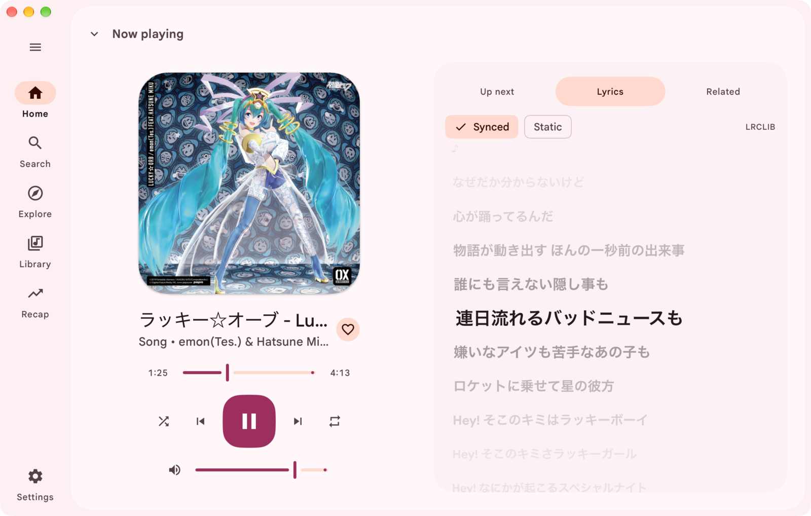

<h1 align="center">
  <picture>
    <source media="(prefers-color-scheme: dark)" srcset="docs/brand/wordmark-dark.svg">
    
  </picture>
</h1>

A native desktop player for YouTube Music. Meiro draws its own interface in a
native window instead of using a Chromium-based web front end.

> **Beta, and unofficial.** Meiro is an independent project. It is not made,
> endorsed or supported by YouTube or Google, and it uses YouTube's private web
> interfaces, which YouTube can change at any time. When that happens, parts of
> Meiro (browsing, search, playback, sign-in) may stop working until it is
> updated. See [Known issues](#known-issues) and
> [Troubleshooting](#troubleshooting).

## Where the name comes from

Meiro is built with the [MyGO](https://github.com/egoist/mygo) framework, and
its name comes from one of MyGO!!!!!'s songs,
[迷路日々](https://www.youtube.com/watch?v=STgVa-reZkM). The title is written
with the characters for *meiro* (迷路, "maze") and *hibi* (日々, "days"), so it
reads as "maze days" or "meiro days". But the song is pronounced "Melody"
(メロディ), a pun on the English word. The app is named Meiro after the first
half of the title.

## Features

- **Browse.** View your Home feed and Explore, then open artist, album, and
  playlist pages. Sign in to view your Library.
- **Search.** Search from the bar at the top of every page, and narrow the
  results by any of the categories YouTube Music offers for the query. Meiro
  keeps your eight most recent searches.
- **Play.** Play tracks from feeds, search results, and playlists. Seek, adjust
  the volume, move to the previous or next track, shuffle, and repeat the
  current track or queue.
  After you select a track, the compact player stays available while you
  browse. Open the full player to view the queue, lyrics, and related tracks.
- **Follow the lyrics.** The Lyrics tab shows timed lyrics from YouTube Music,
  or from [LRCLIB](https://lrclib.net) when YouTube Music has none. The line
  being sung is lit and glides to the middle as the song plays; click a line to
  jump to it. Switch to Static for the plain text.
- **Auto-play.** Auto-play is on by default. It adds YouTube Music
  recommendations after the current queue ends. Toggle it in the queue.
- **Choose an appearance.** Follow the system theme, or choose light or dark.
  Pick a Material 3 palette, adjust its hue, or use the current track's artwork
  to set the app colours.
- **Cache recent audio.** Meiro caches ten recently played tracks by default.
  Choose a different limit and folder. Tracks are kept in the format YouTube
  serves them, in a private cache folder. Set the limit to `0` to turn off the
  cache.
- **Use keyboard shortcuts.** Press Space to play or pause. Use Command on
  macOS or Ctrl on Linux and Windows with Left or Right to change tracks, K or
  F to open Search, and Comma to open Settings. Hold Command or Ctrl for a
  moment to see its key over each button. Change any of them in Settings, under
  Keyboard.
- **Use system media controls.** Control playback from macOS Now Playing or a
  Linux MPRIS client. Meiro publishes track details, cover art, and playback
  state. It accepts play, pause, stop, previous, next, seek, volume, shuffle,
  and repeat commands.

<p align="center">
  <a href="docs/screenshots/lyrics.png"></a>
</p>

Browse and play public music without signing in. Meiro signs in with a
browser session to show your personalized Home feed and Library.

## Screenshots

These show real pages from a signed-in YouTube Music session. Click one to see it
full size.

<table>
  <tr>
    <td align="center"><a href="docs/screenshots/home.png"></a><br><sub>Home</sub></td>
    <td align="center"><a href="docs/screenshots/explore.png"></a><br><sub>Explore</sub></td>
    <td align="center"><a href="docs/screenshots/library.png"></a><br><sub>Library</sub></td>
  </tr>
  <tr>
    <td align="center"><a href="docs/screenshots/search.png"></a><br><sub>Search</sub></td>
    <td align="center"><a href="docs/screenshots/artist.png"></a><br><sub>Artist</sub></td>
    <td align="center"><a href="docs/screenshots/playlist.png"></a><br><sub>Playlist</sub></td>
  </tr>
  <tr>
    <td align="center"><a href="docs/screenshots/player.png"></a><br><sub>Player and queue</sub></td>
    <td align="center"><a href="docs/screenshots/related.png"></a><br><sub>Related tracks</sub></td>
    <td align="center"><a href="docs/screenshots/stats.png"></a><br><sub>Listening stats</sub></td>
  </tr>
  <tr>
    <td align="center"><a href="docs/screenshots/settings-appearance.png"></a><br><sub>Appearance</sub></td>
    <td align="center"><a href="docs/screenshots/settings-sound.png"></a><br><sub>Equaliser</sub></td>
    <td align="center"><a href="docs/screenshots/settings-keyboard.png"></a><br><sub>Shortcuts</sub></td>
  </tr>
</table>

## Install

Download the latest build for your system from the
[releases page](https://github.com/elianiva/meiro/releases).

**macOS**: open the disk image and drag Meiro to Applications. The app is not
notarized by Apple yet, so the first time, right-click it and choose **Open**
(or allow it under System Settings > Privacy & Security).

**Linux**: install the `.deb` on Debian or Ubuntu, or the `.rpm` on Fedora or a
compatible RPM-based distribution. You can also make the `.AppImage` executable
and run it, or unpack the `.tar.gz` and run its `install.sh`. All Linux builds
need GTK 3 and WebKitGTK 4.1.

**Windows**: run the `-setup.exe` installer. **Windows support is untested.**
I don't have Windows to test it, but it's there if you want it. Feel free to
open any issues though.

## Signing in

To see your personalized Home feed and Library, choose **Sign in** and then
**Sign in with a browser window**. Meiro opens a separate browser window with a
new, empty profile, and you sign in to your Google account there. Meiro never
sees your password. When the sign-in finishes, Meiro takes the YouTube Music
session from that window, closes it, and deletes its profile.

Meiro opens the window in your system's default browser when that browser is
Chrome, Edge, Brave, Helium, Chromium or Vivaldi. If your default browser is
something else, such as Safari or Firefox, Meiro uses the first of those
browsers that it finds installed.

YouTube Music has no sign-in that lets another app act for you. Meiro does not
use an app-scoped OAuth token, so the session has the same account access as a
browser session. Treat it like a password.

### Limits of the browser window

- **A Chromium-based browser must be installed.** The window needs Chrome,
  Edge, Brave, Helium, Chromium or Vivaldi. Safari and Firefox cannot be used
  for it, even when one of them is your default browser. If you have none of
  the supported browsers, use one of the other ways below.
- **Google can refuse the sign-in.** Google sometimes shows "This browser or
  app may not be secure" for a browser that it thinks software controls. Meiro
  controls the window only to read the session, and it starts the window so
  that the page does not report itself as automated. Google can still decide
  to refuse, and it can change its checks at any time. If it refuses, use one
  of the other ways below.
- **Linux Snap and Flatpak browsers may not work.** They can be blocked from
  the temporary profile folder that Meiro uses.
- **The window is not your browser.** Your bookmarks, extensions, saved
  passwords and other sessions are not there. You may need to complete a
  second-factor step.
- **Close the window only after it finishes.** If you close it early, the
  sign-in stops and you can try again. A sign-in that takes more than five
  minutes stops by itself.
- **The session can still end.** YouTube can end a session at any time, for
  example when you sign out everywhere or change your password. Meiro then asks
  you to sign in again. A session that you took from the sign-in window is
  never opened in a browser again, so it is not renewed behind your back.

### Other ways to sign in

These are under **Advanced** in the sign-in dialog. Sign in at
[music.youtube.com](https://music.youtube.com) in a browser first, then choose
**Import from a browser** in Meiro. Meiro can import from Chrome,
Safari, Firefox, Brave or Edge. It can also import from Helium when it finds a
browser profile. You can also paste the `Cookie` header of a request to
music.youtube.com.

These two ways copy a session that your own browser keeps using. YouTube
replaces the cookies of a session while a browser has it open, and the older
copy then stops working. A copy like this can end within hours, and you have to
sign in again. Prefer the browser window.

Meiro stores the session in the system credential store where available. If
the system has no credential store, Meiro uses a file that only your user can
read. A locked or failing credential store does not trigger this fallback.
Choose **Sign out** to remove Meiro's saved session.

Public browsing and playback do not need an account.

## Troubleshooting

**Where are the logs?** Open **Settings** and choose **Open logs folder** under
Logs. Meiro writes `meiro.log` there, rolling over to three older files. The
top of each file lists the versions of Meiro, ffmpeg and yt-dlp in use. Meiro
removes passwords and cookies from log lines before it writes them, but read a
log before you post it.

**I can't sign in.**
- If the browser window does not open, or Google says the browser is not
  secure, install Chrome, Edge, Brave, Helium, Chromium or Vivaldi, or use one of the
  other ways to sign in.
- If you imported a session and it ended, sign in again with the browser
  window. An imported session stops working when your browser renews its
  cookies.
- To import, sign in at [music.youtube.com](https://music.youtube.com) in the browser
  first, then pick that same browser in Meiro. Use a profile where you are
  signed in to YouTube Music.
- Close the browser, or try again after it has been open for a moment. Some
  browsers lock their cookie file while running.
- On Linux, the browser's cookies are encrypted with the desktop keyring. If
  the keyring is locked or missing, unlock it, or try another browser.
- If YouTube signed you out in the browser, the saved session is no longer
  valid. Choose **Sign out** and sign in again.
- You can browse and play public music without signing in.

**Nothing plays, or a track fails.**
- Check that you are online, then try another track. Some tracks are not
  available in your region or need an account (age-restricted or Premium
  tracks).
- Meiro finds streams with yt-dlp. YouTube changes often, and an old yt-dlp
  stops working. Install a release of Meiro with a newer yt-dlp, or, with a
  minimal build, update the `yt-dlp` on your `PATH`.
- Look for the error in the log (see above).

**ffmpeg or yt-dlp problems.** The full build bundles both. The minimal build
needs `ffmpeg`, `yt-dlp`, and Node.js or Bun on `PATH`; if one is missing or
too old, playback fails. Run `ffmpeg -version` and `yt-dlp --version` in a
terminal to check them. The log header shows which versions Meiro found.

**Linux does not start.** Meiro needs GTK 3 and WebKitGTK 4.1. Install them
with your package manager.

**macOS says the app can't be opened.** Meiro is not notarized yet. Right-click
it and choose **Open**, or allow it in System Settings > Privacy & Security.

Still stuck? Settings has a report button that opens a GitHub issue prefilled
with your versions. Otherwise
[open an issue](https://github.com/elianiva/meiro/issues) and attach the
relevant part of the log.

## Known issues

- Meiro depends on YouTube's private interfaces and on yt-dlp, so a change on
  YouTube's side can break browsing, playback or sign-in until a fix ships.
- The Windows build is untested (see [Install](#install)).
- The macOS app is not notarized, so the first launch needs the manual step
  above.
- Sign-in uses a browser session, because YouTube Music offers no OAuth
  sign-in to other apps. The browser window needs a Chromium-based browser and
  can be refused by Google (see [Limits of the browser window](#limits-of-the-browser-window)).
  Sessions that you import from your own browser can stop working within hours.
- Tracks that YouTube restricts for your region or account may not play.

See the [open issues](https://github.com/elianiva/meiro/issues) for the rest.

## Privacy

Meiro has no account, analytics or telemetry of its own, and no server of its
own. Its network traffic goes to YouTube and Google (the YouTube Music
interface, the streams, the artwork), and, to find streams, through yt-dlp.
If you connect Last.fm in Settings, it also sends what you play there, and
only then.
Releases that update themselves also contact their update server to check for
a new version; turn that off in Settings under Updates.

What Meiro keeps on your device:
- **Settings**, **listening history** (the latest plays, used for the stats),
  and the **playback state**, in the app's user data folder. Settings has a
  button to clear the history.
- **Your session**, if you sign in, in the system credential store, or, when
  there is none, in a file readable only by your user. **Sign out** removes it.
  The session has the same access to your account as the browser session it
  came from, so treat it like a password.
- **Your Last.fm session**, if you connect Last.fm, in a file readable only by
  your user, apart from the settings, which hold only the account's name. Meiro
  never sees your Last.fm password: you approve it on Last.fm's own page.
  Plays that could not be sent wait in a file beside it. **Disconnect** deletes
  both.
- **Cached audio and artwork**, in the cache folder you chose. Set the audio
  limit to `0` to turn the audio cache off.
- **Logs**, with secrets removed, in the logs folder.

Meiro reads cookies only when you choose to sign in, and only to take the
YouTube Music session. With the browser window, it reads them from the window
that it opened. With an import, it reads them from the browser that you pick.

## Build it yourself

You need [Bazel](https://bazel.build/), installed through
[bazelisk](https://github.com/bazelbuild/bazelisk) so it reads the pinned
version from `.bazelversion`.

```sh
bazel run //:dev                          # live reload; ffmpeg and yt-dlp must be on PATH
bazel run //:dist -- --run linux-amd64    # build the production app with bundled tools, then open it
bazel run //:dist -- --run --minimal linux-amd64   # build and open with system ffmpeg, yt-dlp, and Node.js/Bun
```

`bazel run //:dist -- <platform>` builds into `build/<platform>/`. The
platforms are `darwin-universal`, `darwin-arm64`, `darwin-amd64`,
`linux-amd64` and `linux-arm64`.

The minimal build expects `ffmpeg`, `yt-dlp`, and either Node.js or Bun on
`PATH`. It does not bundle any of these tools or a JavaScript runtime.

Releases include full and minimal builds: one universal DMG for macOS, plus
Linux `amd64` and `arm64` `.deb`, `.rpm`, `.AppImage`, and `.tar.gz`
downloads. Minimal downloads include `-minimal` in the filename. See
[`.github/workflows/release.yml`](.github/workflows/release.yml).

## Credits

- [MyGo](https://mygo.egoist.dev/) by [EGOIST](https://github.com/egoist),
  the framework that draws Meiro's native window and interface.
- [ffmpeg](https://ffmpeg.org) decodes the audio,
  [yt-dlp](https://github.com/yt-dlp/yt-dlp) finds the streams, and
  [QuickJS](https://github.com/quickjs-ng/quickjs) runs the JavaScript yt-dlp
  needs to solve YouTube's challenges when Node or Bun is not installed. The
  full build ships all three; the minimal build leaves them all to the system.
  See
  [`resources/THIRD-PARTY-NOTICES.md`](resources/THIRD-PARTY-NOTICES.md).
- [Google Sans](https://github.com/googlefonts/googlesans) sets the text,
  under the SIL Open Font License (`fonts/OFL.txt`).

## License

Meiro is free software, under the [GNU General Public License v3.0](LICENSE).

Meiro is an independent project and is not affiliated with or endorsed by
YouTube or Google.
